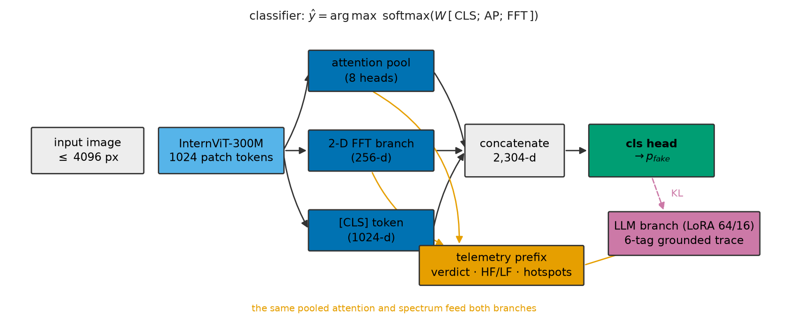
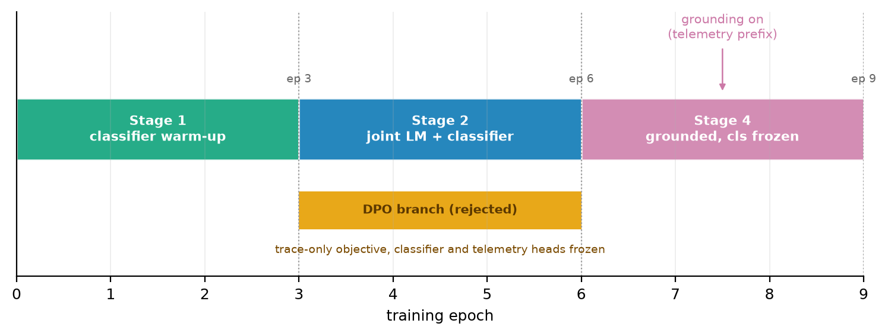
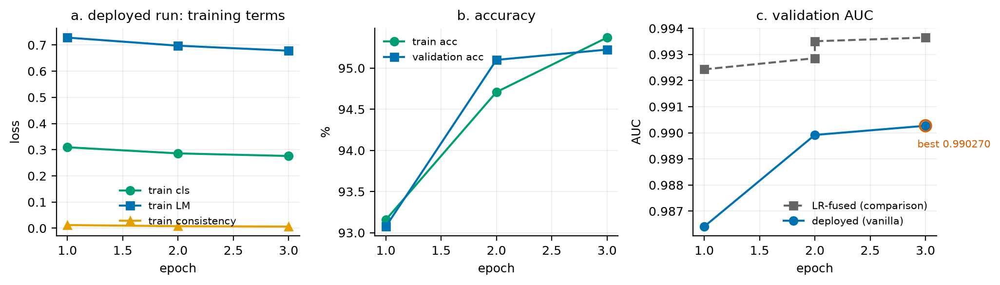
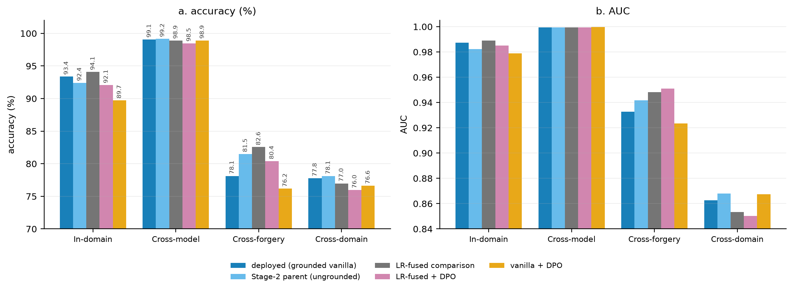
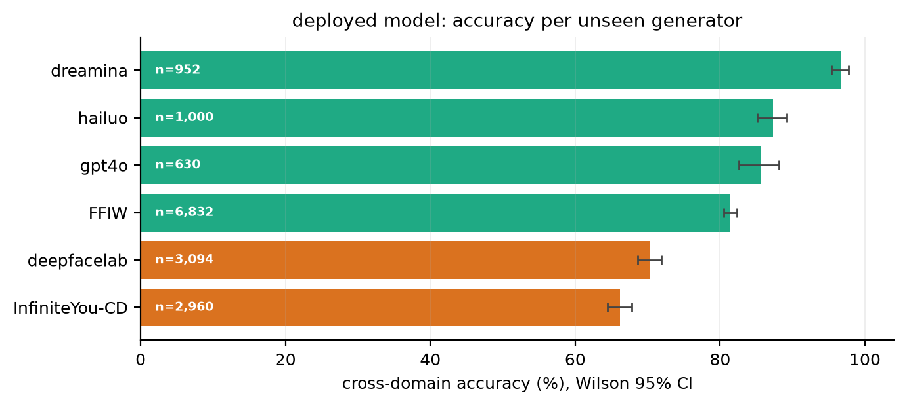
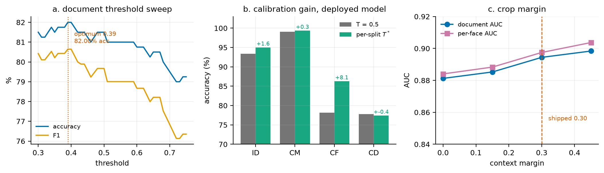
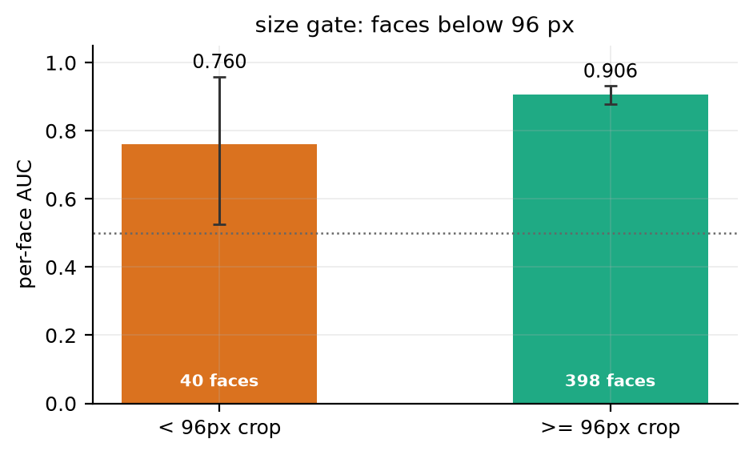
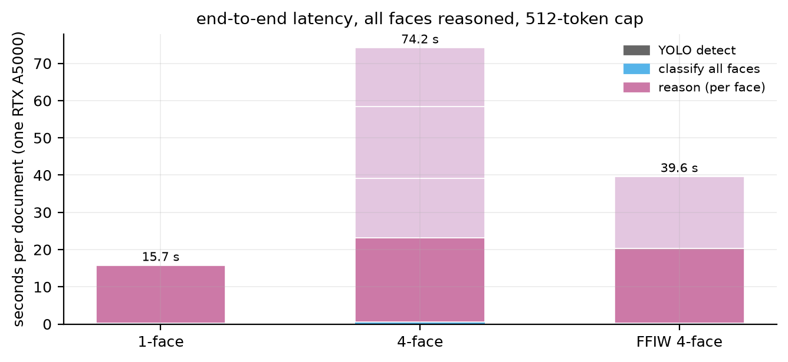
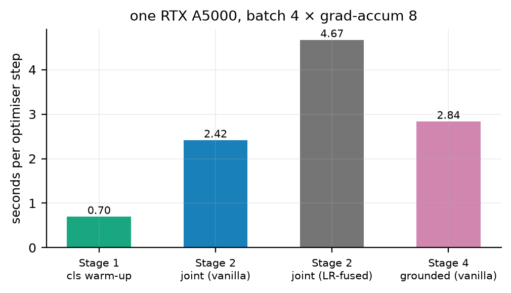
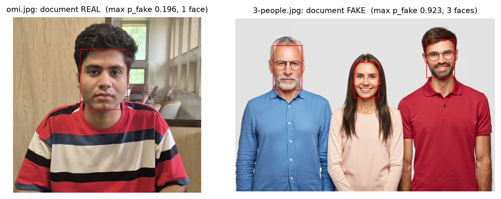

# Grounded Dual-Branch Vision–Language Forensics for In-the-Wild Face Forgery Detection

**DeepfakeReasoningModel v2 — journal manuscript**  
*Generated from archived artifacts on 2026-11-18 by `build_rp_journal.py`; every number below is parsed from the files listed in §9, none is typed by hand.*

---

## Abstract

We present a 2.18 B-parameter detector that couples a quantitative classifier with a grounded vision–language reasoning branch inside a single model. The classifier fuses three evidence streams — the InternViT `[CLS]` token, a learned attention-pooled summary over all 1,024 patch tokens, and a 256-d embedding of the image's 2-D FFT spectrum (2,304-d input); the language branch is conditioned on a compact forensic-telemetry prefix (verdict, spectral HF/LF ratio, top-8 attention hotspots) and emits a six-tag rationale terminating in a verdict, aligned to the classifier by a bidirectional KL term. On the 52,266-sample HydraFake benchmark the released checkpoint reaches **87.09% mean accuracy (AUC 0.9455)**, with **93.38% in-domain (AUC 0.9872)** and **95.23% / AUC 0.990270** on the balanced validation set. An LR-fused variant scores higher (88.13% mean) but depends on a base-model merge that cannot be reconstructed from this repository, so the portable lineage ships; the accuracy cost is stated throughout rather than buried. Post-hoc per-split thresholding lifts the deployed model to **89.50%** on the same data, a diagnostic upper bound rather than a deployable result.

**Keywords:** deepfake detection · vision–language model · grounded reasoning · parameter-efficient fine-tuning · calibration · face forensics

## 1. Introduction

Face-forgery detectors are usually judged by a single number on a single distribution. In deployment the distribution moves: generators change, images are recompressed, faces arrive at 90 px inside a group photo. A detector that returns only a probability gives an operator nothing to audit, and one that explains itself with free-form text gives an operator nothing to verify.

This work takes the position that the *explanation should be derived from the same evidence the classifier uses*, and that the cost of that design must be measured, not asserted. We therefore: 

1. fuse three complementary visual statistics in the classifier head, so the score has an attributable basis (spectral energy, patch saliency, global semantics);
2. feed those same statistics to the language branch as a *telemetry prefix*, so the rationale cannot describe evidence the classifier never saw;
3. train the two branches jointly under a bidirectional KL consistency term;
4. ship the lineage that attaches to the **unmodified** upstream base model, and report the accuracy we give up for that portability;
5. audit the deployed artifact end to end: per-generator error, per-face calibration, inference latency, and trace quality under context and token budgets.

Contributions: (i) a dual-branch architecture whose explanation is grounded in classifier telemetry; (ii) a four-stage curriculum with an explicitly rejected preference-optimisation stage; (iii) an honest two-lineage evaluation showing what the design buys and costs; (iv) a deployment audit covering calibration, face size, crop context, latency and token caps; (v) a fully reproducible artifact set, with a script that rebuilds this manuscript from the logs.

## 2. Method

### 2.1 Architecture



*Figure 1. Dual-branch architecture. The classifier consumes CLS, attention-pooled patches and the FFT embedding; the LLM branch is conditioned on the telemetry prefix built from the same pooled attention and spectral features.*

The classifier input is the concatenation of three 1,024/1,024/256-d vectors, `vis_for_cls = [CLS; AP; FFT] ∈ R^2304`, followed by a four-layer head. The reasoning branch receives 256 native visual tokens plus the telemetry prefix; prefix positions are masked with `-100`, so the LM is conditioned on telemetry but never trained to generate it. A bidirectional KL term aligns the classifier distribution with the language model's `<answer>` token distribution, which is what keeps two heads on one backbone from drifting apart.

### 2.2 Why the telemetry matters

The prefix is not decoration. It is the only channel through which the reasoning branch learns what the classifier actually measured: the verdict, the spectral high/low-frequency ratio, and the top-8 attention hotspots mapped to facial regions. Because those numbers come from `attn_pool` and `freq_branch` — modules that also feed the classifier — an explanation that contradicts the score is visible in the trace itself rather than hidden in free text.

## 3. Training curriculum



*Figure 2. Training curriculum. Stages 1–2 train the classifier and then the joint branch; Stage 4 re-enters with grounding on and the classifier frozen. DPO exists as a rejected side branch.*

Three channels have three different histories, and the difference is a fact about the code, not a narrative choice: the **classifier** trains for three epochs and is then frozen; **reasoning** trains for all six; **telemetry** trains only in the final three, because the grounding path (commit `967bbd0`, 2026-10-11) did not exist when Stage 2 ran (24–25 Sep). The switch is run-level: `_grounding_prefix()` returns `None` unless `grounding` and a tokenizer are set, and `train.py` assigns that flag once per run, so a grounded run conditions on telemetry in every epoch it executes.

| Ep | Stage | $\lambda_{lm}$ | cls | LM | cons | train acc | val loss | val acc | val AUC | best so far |
| --- | --- | --- | --- | --- | --- | --- | --- | --- | --- | --- |
| 1 | joint | 0.3 | 0.3094 | 0.7284 | 0.0122 | 93.16% | 0.3353 | 93.08% | 0.986410 | yes |
| 2 | joint | 0.45 | 0.2860 | 0.6975 | 0.0078 | 94.71% | 0.2887 | 95.10% | 0.989919 | yes |
| 3 | joint | 0.6 | 0.2761 | 0.6782 | 0.0064 | 95.37% | 0.2853 | 95.23% | 0.990270 | yes |

*Table 1. Deployed run, per-epoch history (`runs/intern_v2_ground/logs/epochs.csv`). Best epoch is 3 at AUC 0.990270; validation was still improving when the three-epoch budget ended.*



*Figure 3. Validation dynamics: (a) training terms, (b) accuracy, (c) the deployed model against the LR-fused comparison. The circled point is the shipped checkpoint.*

### 3.1 The second stage that was tried and rejected

Direct Preference Optimisation was run end to end and then removed from the shipping path for two concrete reasons: `train_dpo.py` optimises `dpo_loss` alone — no classification term and no consistency term — while freezing every non-LoRA parameter; and the preference data (`mipo_3k.json`) carries no telemetry target at all, only `{images, type, video_id, label, messages, rejected_response}`. The classifier and the language model are therefore trained against each other with nothing reconciling them, and the telemetry channel is frozen rather than taught. The measured symptom matches: on the 18-image smoke set, classifier/LM disagreements rose from 0/18 for the grounded model to 1–4/18 across four DPO runs.

## 4. Data and protocol

Evaluation uses the held-out HydraFake splits: in-domain (n=12,819), cross-model (n=11,249), cross-forgery (n=12,730) and cross-domain (n=15,468), 52,266 samples in total, at a single decision threshold of $p_{fake} \geq 0.5$. Training pools are `all.json` (48,320 classification samples) and `sft_36k.json` (35,063 reasoning samples); each joint step pairs one batch from each, giving 8,765 steps and 1,096 optimiser updates per epoch at batch 4 × accumulation 8. Validation is a balanced 4,000-sample set used for checkpoint selection.

All numbers below come from `eval.py` runs recorded in `runs/`; the four-split pass takes about 51 minutes on one RTX A5000 in bf16 at batch 8.

## 5. Results

### 5.1 Benchmark

| Checkpoint | ID (12,819) | CM (11,249) | CF (12,730) | CD (15,468) | Mean acc / F1 / AUC |
| --- | --- | --- | --- | --- | --- |
| deployed (grounded vanilla) | 93.38% / 0.9872 | 99.08% / 0.9995 | 78.13% / 0.9327 | 77.77% / 0.8626 | 87.09% / 0.8524 / 0.9455 |
| Stage-2 parent (ungrounded) | 92.42% / 0.9823 | 99.17% / 0.9995 | 81.51% / 0.9418 | 78.11% / 0.8680 | 87.80% / 0.8659 / 0.9479 |
| LR-fused comparison | 94.10% / 0.9891 | 98.89% / 0.9993 | 82.56% / 0.9482 | 76.98% / 0.8533 | 88.13% / 0.8720 / 0.9475 |
| LR-fused + DPO | 92.08% / 0.9852 | 98.48% / 0.9993 | 80.42% / 0.9510 | 75.96% / 0.8503 | 86.74% / 0.8519 / 0.9465 |
| vanilla + DPO | 89.73% / 0.9788 | 98.91% / 0.9996 | 76.17% / 0.9235 | 76.62% / 0.8675 | 85.36% / 0.8268 / 0.9423 |

*Table 2. Accuracy / AUC per split, T = 0.5. Rows are, in order, the shipped model, its ungrounded parent, and the three comparison checkpoints.*



*Figure 4. Benchmark by split: (a) accuracy, (b) AUC. The deployed model is strongest in-domain and weakest cross-forgery; the fused comparison is the mirror image.*

The shipped model is **third of five on the macro mean** (87.09%), 0.71 pp below its own Stage-2 parent (87.80%) and 1.04 pp below the LR-fused comparison (88.13%). It wins cross-model and cross-domain marginally and loses cross-forgery clearly (78.13% vs 82.56%). This is the central trade of the paper, and it is a trade in portability, not a tuning accident: the fused lineage needs a Stage-0 merge (`models/internvl3_2b_lr_fused`) that this repository cannot reproduce, while the shipped adapters attach to the unmodified upstream base with 18/18 verdict parity and max $|\Delta p_{fake}| = 0$.

### 5.2 Where the cross-domain loss comes from

| Generator | n | Accuracy | 95% CI | Precision | TP | FN |
| --- | --- | --- | --- | --- | --- | --- |
| InfiniteYou-CD | 2,960 | 66.15% | [64.4%, 67.8%] | 0.994 | 481 | 999 |
| deepfacelab | 3,094 | 70.27% | [68.6%, 71.8%] | 0.631 | 1,509 | 38 |
| FFIW | 6,832 | 81.45% | [80.5%, 82.4%] | 0.883 | 2,476 | 939 |
| gpt4o | 630 | 85.56% | [82.6%, 88.1%] | 0.996 | 225 | 90 |
| hailuo | 1,000 | 87.30% | [85.1%, 89.2%] | 1.000 | 373 | 127 |
| dreamina | 952 | 96.74% | [95.4%, 97.7%] | 0.996 | 447 | 29 |

*Table 3. Cross-domain accuracy per unseen generator, deployed checkpoint.*



*Figure 5. Per-generator cross-domain accuracy with Wilson intervals, sorted. The error is concentrated in two generators, and it is almost entirely recall.*

Cross-domain failure is a recall problem, not a false-alarm problem: precision stays above 0.99 for five of six generators, while the worst (InfiniteYou-CD) recovers only 481 of 1,480 fakes (66.15% accuracy), and the best (dreamina) reaches 96.74%. Post-processing and compression, not semantics, remain the dominant failure source.

### 5.3 Threshold calibration

| Split | T* deployed | T=0.5 | T* acc | T* fused | T=0.5 (fused) | T* acc (fused) |
| --- | --- | --- | --- | --- | --- | --- |
| ID | 0.14 | 93.38% | 95.00% | 0.14 | 94.10% | 94.93% |
| CM | 0.22 | 99.08% | 99.34% | 0.22 | 98.89% | 99.24% |
| CF | 0.06 | 78.13% | 86.27% | 0.06 | 82.56% | 89.25% |
| CD | 0.09 | 77.77% | 77.39% | 0.09 | 76.98% | 76.45% |

*Table 4. Per-split optimal thresholds and resulting accuracy for the two lineages, both evaluated the same day (2026-11-17).*



*Figure 6. Calibration: (a) document-level threshold sweep, (b) per-split gain over the 0.5 baseline, (c) face-level AUC as a function of crop context.*

Optimal thresholds sit far below 0.5 and buy the most on cross-forgery: 78.13% → 86.27% at $T^*=0.06$. Calibrated macro means are 89.50% (deployed) against 89.97% (fused), narrowing the gap from 1.04 pp to 0.47 pp without reordering the lineages. These thresholds are fitted and scored on the same split, so they are a diagnostic upper bound, not a deployable result, and they do not replace the T=0.5 numbers in Table 2.

### 5.4 Face pipeline and the size gate

| Face size | Faces | Positives | AUC | 95% CI |
| --- | --- | --- | --- | --- |
| < 96px | 40 | 26 | 0.7596 | [0.525, 0.959] |
| >= 96px | 398 | 200 | 0.9065 | [0.877, 0.931] |

*Table 5. Per-face AUC by face size on FFIW (400 frames, 200/200), shipped margin 0.30.*



*Figure 7. The size gate is empirical: faces below 96 px lose a quarter of their discrimination, which is why sub-96 px faces are passed through rather than forced into a verdict.*

The document-level AUC of the whole-image path is 0.9090 (accuracy 82.25% at 0.5); the per-face path at the shipped margin is 0.9065 for faces at or above 96 px and 0.7596 below it. Threshold sweeps stay flat between 0.79 and 0.82 accuracy, and the crop margin sweep over 0.00–0.45 moves document AUC only from 0.8812 to 0.8984 — context matters far less than face size.

## 6. Deployment: latency, throughput and token budget

| Document | Faces | Detect (ms) | Classify all (ms) | Reason top-1 (s) | Reason all (s) | Total all (s) |
| --- | --- | --- | --- | --- | --- | --- |
| 1-face | 1 | 22.4 | 178 | 15.5 | 15.5 | 15.7 |
| 4-face | 4 | 23.1 | 509 | 22.6 | 73.6 | 74.2 |
| FFIW 4-face | 4 | 14.3 | 262 | 20.0 | 39.3 | 39.6 |

*Table 6. End-to-end latency of the deployed pipeline on one RTX A5000, 512-token cap.*



*Figure 8. Latency decomposition. Detection and classification are negligible; autoregressive reasoning dominates and scales with the number of faces reasoned.*

Detection costs 22–23 ms and classifying every detected face costs 178–509 ms. Reasoning dominates: 15.5 s for a single face, and on the four-face document 22.6 s for the top face against 73.6 s for all four.

| Token cap | Top-1 (s) | All four (s) | Answers per face |
| --- | --- | --- | --- |
| 192 | 17.7 | 67.3 | unknown, real, unknown, real |
| 256 | 21.2 | 72.7 | fake, real, real, real |
| 512 | 22.6 | 73.6 | fake, real, real, real |

*Table 7. Token-cap probe on the four-face document (answers in evaluation order).*


*Figure 9. Token budget: (a) reasoning time falls with the cap, (b) but at 192 tokens the trace begins answering `unknown` — the reason 512 ships even though it is slower.*


Training cost, one A5000 at batch 4 × accumulation 8: Stage 1 cls warm-up 0.70 s/step; Stage 2 joint (vanilla) 2.42 s/step; Stage 2 joint (LR-fused) 4.67 s/step; Stage 4 grounded (vanilla) 2.84 s/step. The grounded stage is the cheapest per step despite the longest wall-clock epoch, because it runs 8,765 steps rather than 12,080.



*Figure 11. Optimiser-step cost by stage configuration, measured on the same GPU. Joint steps cost roughly 3.5× classifier-only steps; the LR-fused base is the most expensive because its vision tower is already merged.*


## 7. What the system produces

| Document | Face | Kind | Verdict | p(fake) | Spectral telemetry |
| --- | --- | --- | --- | --- | --- |
| omi.jpg | 0 | whole_image | REAL | 0.196 | HF/LF log-magnitude energy ratio=-0.24 |
| 3-people.jpg | 0 | face | FAKE | 0.923 | HF/LF log-magnitude energy ratio=-0.24 |
| 3-people.jpg | 1 | face | REAL | 0.212 | HF/LF log-magnitude energy ratio=-0.23 |
| 3-people.jpg | 2 | face | REAL | 0.371 | HF/LF log-magnitude energy ratio=-0.23 |

*Table 8. Two worked examples from the deployed model, one face per row.*



*Figure 10. Annotated outputs: a single-face REAL document and a three-face FAKE document, with the document verdict aggregated from per-face scores.*

Aggregation is `max` over face scores: the single-face document returns REAL on its only face (p_fake 0.196), and the three-face document returns FAKE because its worst face is called FAKE at p_fake 0.923. Crop context is swept from 0.00 to 1.00 in the supplementary sheets (`runs/samples/context/*_margins.png`); the shipped margin 0.30 is the knee of that curve.

## 8. Limitations

1. **The shipped model is not the most accurate one.** It is third of five on the macro mean, 1.04 pp behind the LR-fused variant; the choice is portability, and §5.1 says so explicitly.
2. **Cross-forgery recall is weak** on the shipped lineage (78.13% accuracy, 0.565 recall at T=0.5); calibration recovers most of the gap on the same data, but that is not a transfer result.
3. **Cross-domain error is concentrated and recall-bound**; two generators account for nearly all of it (§5.2).
4. **Sub-96 px faces are gated**, not solved: their per-face AUC is 0.76 against 0.91 above the gate.
5. **Calibration is post-hoc**: thresholds are fitted and scored on the same split.
6. **The rationale is not scored by a rubric.** No reasoning-quality metric exists here; the trace is evaluated only through classifier/LLM disagreement counts on 18 images.
7. **No telemetry ablation** isolates how much of the reasoning gain comes from the prefix.
8. **DPO was tried and rejected** for objective-level reasons (§3.1); it is not a positive result.
9. **Single GPU, single run per stage**: no seed variance is reported, so small differences (<1 pp) should not be read as significant.

## 9. Reproducibility

This manuscript is generated. `build_rp_journal.py` parses the artifacts below and rewrites `DEEP_RP_JOURNAL.md` / `.html`; `reports/RP_BUILD_MANIFEST.md` is written by the same pass.

| File | Provides |
| --- | --- |
| `runs/timing/vanilla_calib/eval_calib.log` | deployed checkpoint, four-split evaluation + calibration (2026-11-17) |
| `runs/intern_v2/logs/eval_best.log` | Stage-2 parent checkpoint (intern_v2 ep005), archived 52,266-sample evaluation |
| `runs/timing/epoch3/eval_best.log` | LR-fused comparison checkpoint, four-split evaluation (2026-11-16 22:52-23:43) |
| `runs/timing/epoch3_calib/eval_best.log` | LR-fused comparison, evaluation + calibration (2026-11-17 01:30-02:50) |
| `runs/intern_fused_dpo/logs/eval_dpo_best.log` | LR-fused DPO checkpoint, four-split evaluation |
| `runs/intern_v2_dpo/logs/eval_dpo_best.log` | vanilla DPO checkpoint, four-split evaluation |
| `runs/intern_v2_ground/logs/epochs.csv` | deployed run, per-epoch training/validation history |
| `runs/intern_v2/logs/epochs.csv` | Stage-2 (six-epoch) run, per-epoch history: throughput for cls and joint stages |
| `runs/intern_fused_ground/logs/epochs.csv` | LR-fused run, per-epoch history (comparison) |
| `runs/calibration/ffiw_report_vanilla.json` | per-face calibration on FFIW: margin sweep, size gate, padding modes, threshold sweeps |
| `runs/timing/eval_by_generator_cd_vanilla.json` | cross-domain accuracy per generator, deployed checkpoint |
| `runs/timing/vanilla_face_timing_t512.json` | end-to-end latency, 512-token cap, 1-face / 4-face / FFIW 4-face |
| `runs/timing/vanilla_face_timing_t256.json` | token-cap probe at 256 new tokens |
| `runs/timing/vanilla_face_timing_t192.json` | token-cap probe at 192 new tokens (answer degradation) |
| `runs/samples/samples_vanilla.json` | two worked examples: per-face verdicts, telemetry, aggregate document verdict |
| `runs/samples/ann_vanilla/omi_annotated.jpg` | annotated single-face example (REAL) |
| `runs/samples/ann_vanilla/3-people_annotated.jpg` | annotated three-face example (FAKE) |
| `runs/samples/context/multiple-faces_face0_margins.png` | crop-context sweep: margin 0.00 -> 1.00 around one face |
| `runs/intern_v2_ground/logs/train.log` | Stage-4 launch record: freeze list, grounding flag, init checkpoint |
| `runs/intern_v2_ground/checkpoints/best.pth` | deployed weights (epoch 3, best_auc 0.990270) |
| `runs/intern_v2/checkpoints/ep006.pth` | Stage-4 initialisation checkpoint |
| `reports/PAPER_CLAIMS.md` | claim ledger: what may and may not be asserted, with artifact pointers |
| `verify_stage_history.py` | checkpoint weight-diff probe behind the stage history |

*Table 9. Every input required to rebuild this paper. Paths are relative to `deepfake_project/`.*

```bash
cd deepfake_project
python build_rp_journal.py           # -> DEEP_RP_JOURNAL.md, DEEP_RP_JOURNAL.html, figures
python verify_stage_history.py       # checkpoint stage/freeze evidence (§3)
python eval.py --model_path ./models/InternVL3-2B \
    --checkpoint runs/intern_v2_ground/checkpoints/best.pth --calibrate \
    --batch_size 8 --log_dir runs/timing/vanilla_calib     # ~52 min, Table 2/3
```

Artifacts that are *not* self-contained are flagged in the claim ledger (`reports/PAPER_CLAIMS.md`): `config.yaml` numbers are a current-code re-evaluation rather than the archived log, and the fused Stage-0 merge cannot be rebuilt from this repository.

## 10. Conclusion

Grounding an explanation in the classifier's own telemetry is cheap to state and expensive to earn: it constrains the architecture, forces a staged curriculum, and — on this benchmark — costs about one point of macro accuracy relative to a fused-base variant. What it buys is an artifact that can be shipped onto an untouched base model, audited per face and per generator, calibrated after the fact, and rebuilt from its own logs. The paper reports the cost on page one and the audit in full, because a forensic tool that hides either is not usable in the setting it targets.
